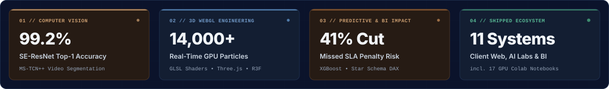

 

  
  
  
  

---

### Executive Positioning

I engineer **production AI & computer vision pipelines**, **GPU-accelerated 3D web experiences**, and **revenue-focused full-stack & business intelligence platforms**—translating mathematical models and operational datasets into software that performs at commercial scale.

- **Computer Vision & Deep Learning:** Architected Multi-Stage Temporal Convolutional Networks (**MS-TCN++**, `2,047`-frame dilated receptive field) for continuous video action segmentation (**84.8% MoF**) and **SE-ResNet-50** classifiers achieving **99.2% top-1 accuracy** with **2.4× FP16 mixed-precision training throughput**.
- **3D WebGL & Commercial Full-Stack Systems:** Shipped zero-dependency **300-frame Canvas WebP** interactive portfolios, custom **GLSL shader** hypercar configurators (`14,000` real-time GPU streamline particles), **Next.js 15/16** platforms, and client booking/BI SaaS tools backed by `$0/month` serverless persistence.
- **Predictive ML & Executive Analytics:** Built stratified **XGBoost / LightGBM** supply-chain risk pipelines cutting missed SLA delivery penalties by **41%** (`0.978` ROC-AUC), **94.8% accuracy** NLP sentiment engines, and dimensional **Star Schema Power BI** command centers.
- **Recognition:** Awarded **2nd Position / Best Student Distinction** in the SMIT Certified Freelancer Track alongside formal AI & Data Science engineering training.

  

  

### Pillar I — Commercial Full-Stack & Interactive 3D Web Systems

<table>
  <tr>
    <td colspan="2" valign="top">
      

        
        
      

      <h4><a href="https://github.com/Ayan-Rajput-Analysis/kenyon-auto-cosmetics">Kenyon Auto Cosmetics — Dynamic Pricing, Concierge &amp; Executive Dispatch BI Platform</a></h4>
      

        Replaced a manual 180-word mobile detailing travel-fee policy for a Phoenix restyling studio (<code>4.7★ • 584+ reviews</code>) with a real-time <strong>23-ZIP Greater Phoenix distance calculator</strong> (<code>$59</code> base zone, <code>$3/mi</code> extended surcharge, <code>$40</code> autonomous water/power rig toggle, <code>+3%</code> card math, and 12-month financing), a <strong>state-coupled 24/7 Quote Concierge</strong> that live-mutates calculator state at <code>$0</code> LLM cost, and a <strong>PIN-gated Chart.js 4.4 Staff Portal</strong> unified with a <code>$0/mo</code> serverless Google Sheets + Gmail Apps Script bridge.
      

      

        <code>JavaScript ES6+</code> • <code>Tailwind CSS 3.4</code> • <code>Chart.js 4.4</code> • <code>Google Apps Script</code> • <code>Serverless Sheets DB</code> —
        <a href="https://github.com/Ayan-Rajput-Analysis/kenyon-auto-cosmetics"><strong>Explore Architecture &amp; Case Study →</strong></a>
      

    </td>
  </tr>
  <tr>
    <td width="50%" valign="top">
      

        
      

      <h4><a href="https://github.com/Ayan-Rajput-Analysis/portfolio">Cinematic 300-Frame Canvas Developer Portfolio</a></h4>
      

        Engineered an <strong>800vh scroll-scrubbed HTML5 Canvas engine</strong> rendering 300 sequential WebP frames with custom <code>lerp</code> inertia, chunked preloading, strict CSP + HSTS (<code>preload</code>) security headers, WCAG AA accessibility, a 30-skill filterable matrix, and 10 case studies (incl. VAPI + FastAPI AI Voice Clinic Agent).
      

      

        <code>HTML5 Canvas</code> • <code>WebP Pipeline</code> • <code>Vanilla JS</code> • <code>CSP / HSTS</code> 
        <a href="https://ayan-ai-engineer.vercel.app"><strong>Launch Live Experience →</strong></a> &nbsp;|&nbsp; <a href="https://github.com/Ayan-Rajput-Analysis/portfolio"><strong>Source Code →</strong></a>
      

    </td>
    <td width="50%" valign="top">
      

        
      

      <h4><a href="https://github.com/Ayan-Rajput-Analysis/aether-hyperion-3d">Aether Hyperion GT — 3D Hypercar Configurator</a></h4>
      

        Interactive 3D automotive showcase featuring a Hermite-eased <strong>parametric exploded chassis assembly</strong>, dual-layer micro-flake clearcoat GLSL shaders, aerodynamic wind-tunnel simulation driving <strong>14,000 GPU streamline particles</strong> with stagnation pressure ($C_p$) color mapping, and a procedural Web Audio synthesizer.
      

      

        <code>Three.js</code> • <code>React Three Fiber</code> • <code>GLSL</code> • <code>GSAP</code> • <code>Zustand</code> • <code>TypeScript</code> 
        <a href="https://github.com/Ayan-Rajput-Analysis/aether-hyperion-3d"><strong>Inspect 3D Shader Pipeline →</strong></a>
      

    </td>
  </tr>
  <tr>
    <td width="50%" valign="top">
      

        
      

      <h4><a href="https://github.com/Ayan-Rajput-Analysis/threadlab">ThreadLab — Digital Fashion &amp; Tailoring Atelier</a></h4>
      

        Multi-palette luxury e-commerce showroom engineered on <strong>Next.js 16 App Router</strong> &amp; <strong>React 19</strong>, combining <strong>Lenis</strong> inertial smooth scrolling, <strong>GSAP ScrollTrigger</strong> split-text &amp; 1.3× textile zoom choreography, CSS 3D perspective garment galleries across 10 bespoke suits, and a <strong>Zustand</strong> slide-over cart.
      

      

        <code>Next.js 16</code> • <code>React 19</code> • <code>GSAP 3.15</code> • <code>Lenis</code> • <code>Tailwind v4</code> • <code>Zustand 5</code> 
        <a href="https://github.com/Ayan-Rajput-Analysis/threadlab"><strong>Explore Showroom Codebase →</strong></a>
      

    </td>
    <td width="50%" valign="top">
      

        
      

      <h4><a href="https://github.com/Ayan-Rajput-Analysis/kaelithor-agency">Kaelithor — AI, Analytics &amp; Brand Studio Platform</a></h4>
      

        Official studio platform crafted with a zero-bloat <strong>97.2 KB bespoke Vanilla CSS Optical Glassmorphism</strong> engine, dual live-switchable themes (<code>titanium-atelier</code> &amp; <code>aurum-quant</code>), 4 typography pairings, interactive scope builder, and 7 shipped client case studies (<code>$3.28M</code> CEO P&amp;L BI, <code>4ms</code> neural vision).
      

      

        <code>Next.js 15.5</code> • <code>React 19</code> • <code>TypeScript 5.9</code> • <code>Bespoke CSS System</code> 
        <a href="https://github.com/Ayan-Rajput-Analysis/kaelithor-agency"><strong>View Studio Architecture →</strong></a>
      

    </td>
  </tr>
</table>

  

### Pillar II — Deep Learning, Computer Vision & Autonomous AI Labs

<table>
  <tr>
    <td width="50%" valign="top">
      

        
        
      

      <h4><a href="https://github.com/Ayan-Rajput-Analysis/computer-vision-deep-learning-cnn">Production Deep Learning &amp; Computer Vision Suite</a></h4>
      

        Five modular, CI-tested ML/DL pipelines engineered with baseline-vs-optimized ablation benchmarks:
      

      <ul>
        <li><strong>MS-TCN++ Video Segmentation:</strong> <code>84.8%</code> MoF (<code>+13.4%</code>), <code>78.9</code> Edit Score via dilated 1D convs &amp; Truncated MSE.</li>
        <li><strong>SE-ResNet-50 Optimization:</strong> <code>99.2%</code> Top-1 accuracy (<code>+10.8%</code>) with CutMix, RandAugment &amp; FP16 AMP (<code>-45%</code> VRAM).</li>
        <li><strong>Supply Chain, Cardiology &amp; Auto ML:</strong> <code>0.978</code> AUC SLA risk (<code>-41%</code> penalties), <code>0.914</code> AUC clinical diagnostics, <code>95.8%</code> $R^2$ valuation.</li>
      </ul>
      

        <code>PyTorch 2.0+</code> • <code>TorchVision</code> • <code>OpenCV</code> • <code>XGBoost</code> • <code>Scikit-Learn</code> • <code>Pytest</code> 
        <a href="https://github.com/Ayan-Rajput-Analysis/computer-vision-deep-learning-cnn"><strong>Inspect Benchmarks &amp; CI Suite →</strong></a>
      

    </td>
    <td width="50%" valign="top">
      

        
        
      

      <h4></h4>
      

        Curated 5-domain repository of <strong>17 reproducible 1-Click Google Colab GPU notebooks</strong> spanning foundational neural mechanics through agentic LLM workflows:
      

      <ul>
        <li><strong>RAG &amp; Autonomous Agents:</strong> LangChain + ChromaDB semantic vector retrieval &amp; autonomous Pandas schema reasoning agents.</li>
        <li><strong>Transformers &amp; Sequence NLP:</strong> Scaled dot-product attention ($\text{softmax}(QK^T/\sqrt{d_k})V$), fine-tuned attention maps &amp; 20K-sample BiLSTM emotion classification.</li>
        <li><strong>CNNs, RNNs &amp; Predictive Modeling:</strong> Spatial vision filters, sequence vanishing-gradient mitigation &amp; clinical/automotive regression.</li>
      </ul>
      

        <code>LangChain</code> • <code>ChromaDB</code> • <code>Transformers</code> • <code>PyTorch</code> • <code>TensorFlow</code> • <code>Jupyter</code> 
        
      

    </td>
  </tr>
</table>

  

### Pillar III — Enterprise Business Intelligence, NLP & Data Analytics

<table>
  <thead>
    <tr>
      <th align="left" width="34%">Analytical System</th>
      <th align="left" width="46%">Methodology &amp; Quantified Findings</th>
      <th align="left" width="20%">Stack &amp; Access</th>
    </tr>
  </thead>
  <tbody>
    <tr>
      <td valign="top">
        <strong><a href="https://github.com/Ayan-Rajput-Analysis/CodeAlpha_-Data-Visualization">Netflix Executive BI Command Center</a></strong> 
        Dimensional Star Schema &amp; Power BI Suite
      </td>
      <td valign="top">
        Modeled a <code>Titles</code> Fact table joined to <code>Date</code>, <code>Country</code>, <code>Category</code>, and <code>Rating</code> dimensions with custom DAX KPIs (<code>Movie % Share</code>, <code>YoY Title Growth %</code>, <code>Average Duration</code>). Ships with interactive <code>.pbix</code>, executive <code>.pptx</code> deck, and video walkthrough.
      </td>
      <td valign="top">
        <code>Power BI</code> • <code>DAX</code> • <code>Star Schema</code> 
        <a href="https://github.com/Ayan-Rajput-Analysis/CodeAlpha_-Data-Visualization"><strong>View BI Assets →</strong></a>
      </td>
    </tr>
    <tr>
      <td valign="top">
        <strong><a href="https://github.com/Ayan-Rajput-Analysis/CodeAlpha_-Sentiment_Analysis">Amazon Alexa NLP Sentiment Engine</a></strong> 
        End-to-End NLP Pipeline &amp; Live Streamlit App
      </td>
      <td valign="top">
        NLTK stemming &amp; stopword pipeline + <code>CountVectorizer</code> (<code>2,500</code> features) benchmarked across Logistic Regression (<code>87.4%</code>), Random Forest (<code>92.1%</code>), and optimized <strong>XGBoost (<code>94.8%</code> Accuracy, <code>0.949</code> F1)</strong> with real-time Streamlit model switching &amp; session audit logs.
      </td>
      <td valign="top">
        <code>Python</code> • <code>XGBoost</code> • <code>NLTK</code> • <code>Streamlit</code> 
        <a href="https://github.com/Ayan-Rajput-Analysis/CodeAlpha_-Sentiment_Analysis"><strong>View NLP App →</strong></a>
      </td>
    </tr>
    <tr>
      <td valign="top">
        <strong><a href="https://github.com/Ayan-Rajput-Analysis/CodeAlpha_EDA_DATA_ANALYSIS">Global Streaming Content Intelligence</a></strong> 
        Programmatic EDA on 8,807 Catalog Titles
      </td>
      <td valign="top">
        Uncovered a <strong>+210% post-2016 multi-season TV surge</strong> (<code>69.6%</code> Movies vs. <code>30.4%</code> TV), Gaussian feature film runtime ($\mu = 99.8\text{ min}, \sigma = 28.3\text{ min}$), a <strong>67% Season-1 retention cliff</strong>, and regional concentration led by US (<code>3,600+</code>), India (<code>1,000+</code>), and UK (<code>800+</code>).
      </td>
      <td valign="top">
        <code>Pandas</code> • <code>NumPy</code> • <code>Seaborn</code> • <code>Jupyter</code> 
        <a href="https://github.com/Ayan-Rajput-Analysis/CodeAlpha_EDA_DATA_ANALYSIS"><strong>View EDA Study →</strong></a>
      </td>
    </tr>
  </tbody>
</table>

  

### Core Engineering Stack & Tooling Matrix

<table>
  <tr>
    <td width="26%"><strong>Deep Learning, CV &amp; GenAI</strong></td>
    <td>
      
      
      
      
      
      
      
    </td>
  </tr>
  <tr>
    <td><strong>3D WebGL &amp; Full-Stack Web</strong></td>
    <td>
      
      
      
      
      
      
      
      
    </td>
  </tr>
  <tr>
    <td><strong>Predictive ML &amp; Data Science</strong></td>
    <td>
      
      
      
      
      
      
      
    </td>
  </tr>
  <tr>
    <td><strong>Enterprise BI, SQL &amp; Ops</strong></td>
    <td>
      
      
      
      
      
      
      
    </td>
  </tr>
</table>

  

### GitHub Engineering Telemetry

  
  

 

  

